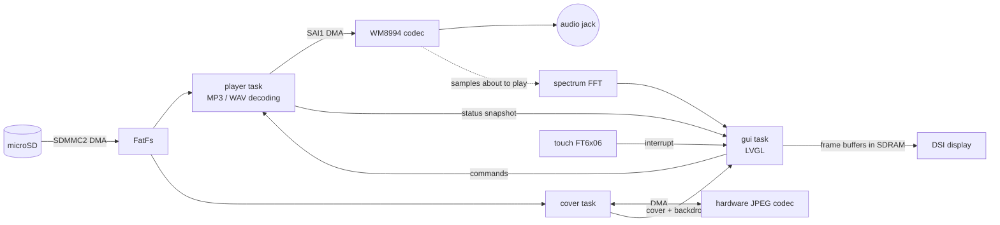

# STM32F769 Music Player

[](https://github.com/Yuanzjls/Audio_Player_stm32f769disco/actions/workflows/build.yml)
[](https://github.com/Yuanzjls/Audio_Player_stm32f769disco/releases/latest)


A touch-screen MP3 / WAV player for the STM32F769I-Discovery board: songs from the microSD card,
sound through the board's audio jack, a [LVGL](https://lvgl.io) 9 user interface on FreeRTOS.

## Features

* **Home screen with apps**: Music, System info and Settings, plus a now-playing bar; the
  music keeps playing outside the Music app (a home button in every app leads back).
* **MP3 and WAV**, including variable-bitrate MP3, with title, artist and length from the ID3 tags.
* **Album covers**: the picture embedded in the song, decoded by the chip's hardware JPEG codec,
  with a blurred copy of it behind the player.
* **Spectrum analyser**: 32 bands, computed live from what is playing (CMSIS-DSP FFT).
* **Library of up to 4096 songs**, in name order, in a panel that folds away.
* **Shuffle** (on by default, starting at a random song), repeat-one, previous/next, seek, volume.
* **Song titles in any language** (e.g. Chinese), with a TrueType font from the SD card.
* **Low CPU load**: interrupt / DMA driven throughout; about 12 % of the CPU while an MP3 plays
  with the spectrum. The System info app shows the CPU load, memory, SD card and tasks.
* **Settings** (volume, screen brightness, shuffle at start, screen off after a while), saved
  on the SD card.
* **Robust SD-card access**: failed reads are retried, after re-initialising the card if needed.

## Quick start (prebuilt firmware)

1. Download `Audio_Player_stm32f769disco.bin` from the
   [latest release](https://github.com/Yuanzjls/Audio_Player_stm32f769disco/releases/latest).
2. Connect the board's ST-LINK USB port to the computer. A drive named `DIS_F769NI`
   appears: copy the `.bin` onto it. The board programs itself and restarts.
3. Prepare a microSD card as described in [SD card](#sd-card) below, insert it, and plug
   headphones or speakers into the board's audio output jack.

The log (version, songs, errors) is on the ST-LINK virtual COM port at 115200 8N1.

Supported files:
* **WAV**: PCM 16-bit, mono or stereo, 8 – 96 kHz.
* **MP3**: MPEG-1/2/2.5 Layer III, constant or variable bitrate, mono or stereo, 8 – 48 kHz.
  Title and artist come from ID3v2 / ID3v1 tags (UTF-8, UTF-16 and GBK text), otherwise from
  "Artist - Title" file names. The cover is the embedded ID3 picture (baseline JPEG; PNG and
  progressive JPEG get a placeholder). The length is exact from a Xing/VBRI header, or measured by a
  background scan while the song plays.

Hardware: STM32F769I-Discovery with the OTM8009A display (MB1166 revisions up to A-08). Later
revisions ship an NT35510 panel, which the display driver does not support yet.

## SD card

```
/Music/*.wav      songs (.wav, .mp3), listed and played in name order
/Music/*.mp3
/font.ttf         optional: font for the song titles (font.otf / font.ttc also work, for a
                  .ttc collection the first face is used), e.g. Noto Sans SC for Chinese.
                  Without it only Latin titles render.
/settings.txt     written by the Settings app (key=value lines, can be edited by hand)
```

Only distribute fonts whose license allows it; e.g. Microsoft YaHei comes with Windows and is
fine on your own board, but must not be committed to this repository.

## Build (CMake)

Requirements: CMake ≥ 3.20, Ninja, [Arm GNU Toolchain](https://developer.arm.com/downloads/-/arm-gnu-toolchain-downloads) (`arm-none-eabi-gcc` on PATH).
On Windows: `winget install Kitware.CMake Ninja-build.Ninja Arm.GnuArmEmbeddedToolchain xpack-dev-tools.openocd-xpack`

LVGL, FreeRTOS and the ST drivers are git submodules, so clone recursively:

```sh
git clone --recursive https://github.com/Yuanzjls/Audio_Player_stm32f769disco.git
# or, in an existing clone:
git submodule update --init

cmake --preset Debug          # or Release
cmake --build build/Debug     # -> build/Debug/Audio_Player_stm32f769disco.elf/.hex/.bin
```

## Flash

* `cmake --build build/Debug --target flash` – STM32CubeProgrammer CLI if installed, otherwise OpenOCD.
  Requires the ST-LINK USB driver ([STSW-LINK009](https://www.st.com/en/development-tools/stsw-link009.html)) on Windows.
* `cmake --build build/Debug --target flash_drive` – copies the `.bin` to the board's `DIS_F769NI` USB drive
  (drag-and-drop programming, no driver needed). Override the drive with `-DFLASH_DRIVE=F:/`.

## VS Code

* Status bar buttons **Build | Flash | Monitor | Flash+Monitor | Reset** (via the recommended [Tasks](https://marketplace.visualstudio.com/items?itemName=actboy168.tasks) extension)
* Serial monitor: log output on the ST-LINK virtual COM port, auto-detected, **115200 8N1**.
  From a terminal: `powershell -ExecutionPolicy Bypass -File tools/serial_monitor.ps1 [-Port COM8]`
* `Ctrl+Shift+B` – build (Debug)
* `Ctrl+Shift+P` → **Tasks: Run Task** → *Flash (Debug)*, *Flash (Release)*, *Flash via USB drive*, *Rebuild*, *Clean*, *Reset board*
* `F5` – build, flash and stop at `main()`. Pick *Debug (OpenOCD + GDB)* (C/C++ extension only) or
  *Debug (Cortex-Debug)* (with the [Cortex-Debug](https://marketplace.visualstudio.com/items?itemName=marus25.cortex-debug) extension: register/peripheral/FreeRTOS views).

## Tests

The board-independent parts (ID3 tags and cover location, WAV and MP3 decoding, the spectrum
analysis, the settings file) have unit tests that run on the PC, against fakes for the SD card, the log and the audio
output (`tests/support/fakes.c`). The MP3 tests decode real files from `tests/fixtures`
(regenerate them with `make_fixtures.sh`). They need a host C compiler (e.g. gcc; on Windows
`winget install BrechtSanders.WinLibs.POSIX.UCRT`):

```sh
cmake -S tests -B build/tests -G Ninja      # Linux: add -DSANITIZE=ON for ASan + UBSan
cmake --build build/tests
ctest --test-dir build/tests --output-on-failure
```

GitHub Actions runs them on every push, with the sanitizers, next to the firmware builds.

## Code layout

| Folder | Contents |
|---|---|
| `App/` | `player` (library + streaming task, command queue), `decoder` (format-independent decoding: `decoder_wav`, `decoder_mp3`, `id3`), `spectrum` (FFT band levels with CMSIS-DSP), `cover_art` (cover pictures with the hardware JPEG codec), `settings` (settings.txt); LVGL screens: `shell` (home screen, app switching), `app_music`, `app_sysinfo`, `app_settings` |
| `Board/` | `audio_out` (SAI1 + WM8994), `display` (DSI/LTDC/OTM8009A as LVGL display), `touch` (FT6x06), `lv_fs_sd` (LVGL file access with FatFs fast seek), `i2c_bus` (lock for the shared codec/touch I2C), `log` (UART), `sysmon` (CPU load, heap use) |
| `Core/` | start-up (`main.c`: MPU, caches, clocks, tasks), interrupt handlers, HAL/FreeRTOS/LVGL configuration |
| `Middlewares/` | LVGL, the FreeRTOS kernel, minimp3 and CMSIS-DSP (submodules) |
| `Drivers/` | ST HAL, CMSIS, board support package and chip drivers (submodules, CMSIS Core copied); `HAL_Patches/`: a HAL file built in place of ST's (shorter SD command timeout, see its header) |
| `tests/` | Host unit tests (see [Tests](#tests)) |
| `FATFS/` | FatFs, with the SD-card glue in `diskio.c` and the settings in `ffconf.h` |

Tasks: `player` (priority 3) streams audio; `gui` (priority 1) runs LVGL. The UI only talks to the
player through `player_*()` commands and reads a status snapshot, so the two never share state directly.

## How it runs



Everything is interrupt / DMA driven, so the CPU sleeps (`WFI` in the FreeRTOS idle hook) whenever
there is nothing to do:

| Part | Mechanism |
|---|---|
| Audio | SAI1 circular DMA; half/full-transfer interrupts wake the `player` task to decode the next half (MP3 decoding takes ~6 % CPU). Clocked from PLLI2S for the exact 44.1 kHz or 48 kHz family. |
| SD card | SDMMC2 DMA; the completion interrupt releases a semaphore. DMA buffers live in DTCM, which is never cached; reads into other (cached) memory go through a bounce buffer there. A failed read is retried, after re-initialising the card if needed. |
| Display | DSI adapted command mode: on the panel's tearing-effect interrupt the finished LVGL frame (double-buffered in SDRAM) is sent in 4 tear-free stripes. Nothing is sent while the screen is unchanged, and LVGL sleeps (instead of spinning) until a frame buffer is free again. |
| Cover | The hardware JPEG codec, fed and drained by DMA; its interrupts wake the `cover` task, which averages the output into the 160 px cover and renders the blurred backdrop. |
| Touch | The FT6x06 INT line (EXTI) wakes the `gui` task; I2C is only read while a finger is down. |
| Delays | `HAL_Delay()` sleeps the calling task instead of busy-waiting. |

The status line measures the CPU load as the share of time not spent in that `WFI` (timed with TIM2).
While an MP3 plays with the spectrum it reads about 12 %.

Codec volume changes (a few I2C writes) and the UART log stay blocking: they are short and rare.

## Third-party components

| Component | Version | Source |
|---|---|---|
| LVGL | 9.6.0 | submodule `Middlewares/lvgl` |
| minimp3 | commit ea99364 (2026-07-27) | submodule `Middlewares/minimp3` (public domain) |
| CMSIS-DSP | v1.18.0 | submodule `Middlewares/CMSIS-DSP` (FFT for the spectrum) |
| FreeRTOS kernel | V11.3.1 | submodule `Middlewares/FreeRTOS-Kernel` (port `GCC/ARM_CM4F`) |
| STM32F7 HAL | v1.3.3 | submodule `Drivers/STM32F7xx_HAL_Driver` |
| CMSIS device F7 | v1.2.10 | submodule `Drivers/CMSIS/Device/ST/STM32F7xx` (startup + system files) |
| CMSIS Core | 5.9.0 (Core 5.6) | copied into `Drivers/CMSIS/Include` |
| 32F769I-Discovery BSP | v2.2.1 | submodule `Drivers/BSP/STM32F769I-Discovery` |
| BSP components | common v4.0.1, wm8994 v2.2.1, otm8009a v1.0.7, nt35510 v1.0.3, ft6x06 v1.0.2, adv7533 v1.0.2 | submodules `Drivers/BSP/Components/*` |
| FatFs | R0.16 | copied into `FATFS/` |

The ST driver versions are the set pinned by STM32CubeF7 v1.17.4. Newer major releases of
the chip drivers (wm8994 v3, otm8009a v2, ...) use a different API and do not fit this BSP.

## Demo video

https://www.youtube.com/watch?v=nAqI61Whyyc&feature=youtu.be (the first, STemWin version of the player)

## Todo

* Add other formats (FLAC, Ogg Vorbis).
* Add lyric support.
* PNG and progressive-JPEG covers (the hardware codec only decodes baseline JPEG).
* Support the NT35510 panel of later board revisions.
* Keep the font and images in the board's 64 MB QSPI flash.
